# moh-icons

SVG icons for *Medal of Honor: Allied Assault* and its two expansions.

| Original&nbsp;design | New&nbsp;design | Alternative | Game | Based on |
|:-:|:-:|:-:|---|---|
|  |  | | Allied Assault | The Allied star, the WWII vehicle marking. No background. |
|  |  | 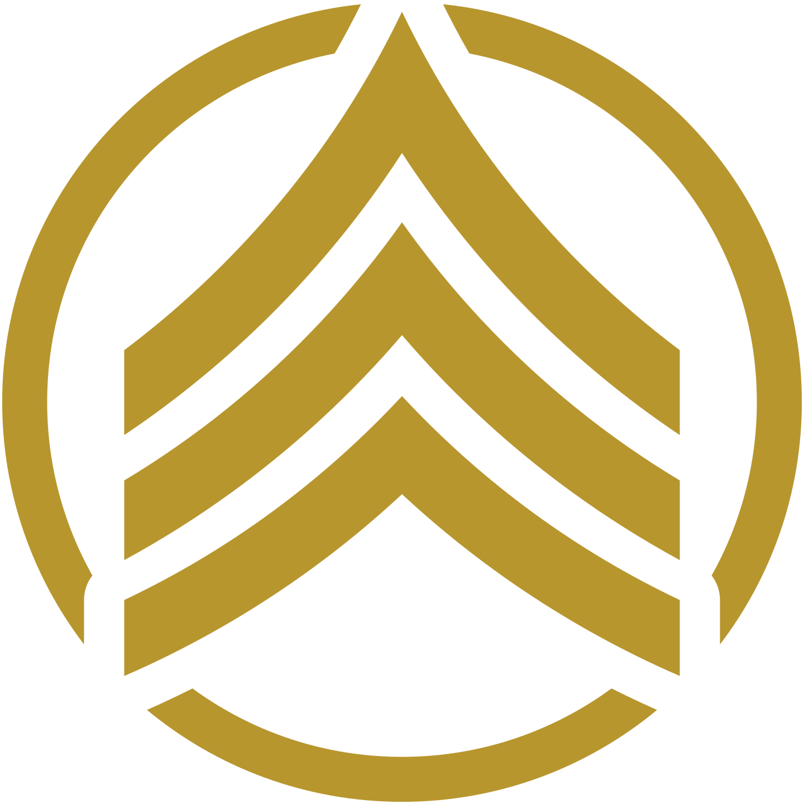 | Spearhead | Three curved rank chevrons. The alternative has no background. |
|  |  |  | Breakthrough | The Special Forces patch: a dagger and three lightning bolts. The alternative has no background. |
| |  |  | Launcher | A chain link, for connecting to a server. The alternative is two chevrons over a banner, after the Call of Duty Companion logo. |
| |  | 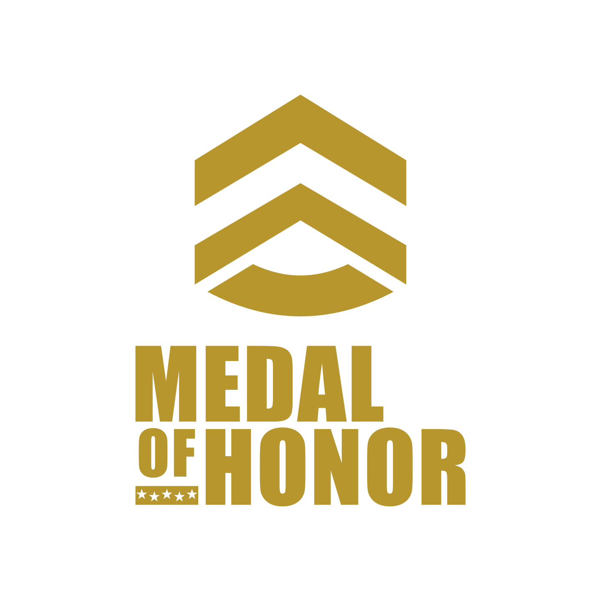 | Launcher (alternative) | The chevrons over the Impact wordmark, laid out like the Call of Duty Companion icon. The alternative uses the stacked wordmark, which stays readable down to about 64px. |

All the icons use the same gold (`#B8962E`), and the emblems break through the ring. Spearhead and Breakthrough keep their original backgrounds: green `#244C31` and indigo `#2C2564`. The originals are the games' 32×32 icons, in [`originals/`](originals).

## Logo

The *Allied Assault* logo without its shadows, in its original font (the logo's own Adobe Garamond letters, with stars cut out of the bar) and rebuilt in Cinzel Bold. Each comes with RELOADED in place of ALLIED ASSAULT too, with the frame narrowed around it; in the original font, RELOADED uses letters from the logo itself.

| Original font | Original font, Reloaded | Cinzel | Cinzel, Reloaded | Version |
|:-:|:-:|:-:|:-:|---|
|  |  |  |  | Steel blue `#98BADF` on a dark grey `#414141` plate, the original's colours. |
|  |  |  |  | Steel blue, without the plate. |
|  |  |  |  | White. |
|  |  |  |  | Gold (`#B8962E`). |

### Wordmark

MEDAL, OF over the star bar, HONOR and ALLIED ASSAULT, with no frame or ring, in each font we tried. Each font keeps its own letter spacing, so narrow fonts come out taller.

| Gold | White | Steel blue | Font |
|:-:|:-:|:-:|---|
| 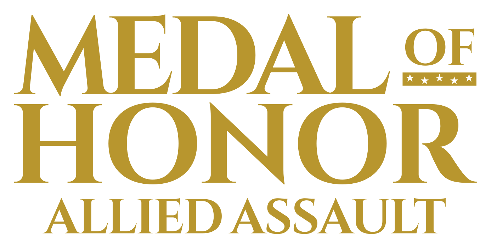 |  | 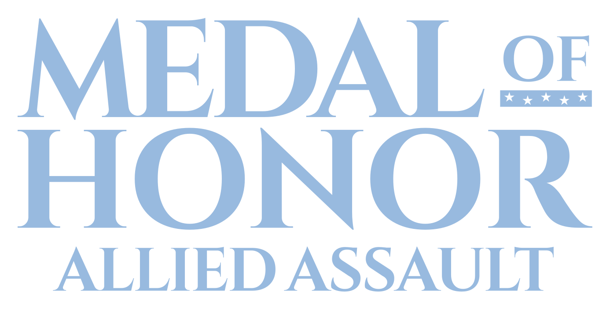 | Cinzel Bold, from the old launcher icon. |
| 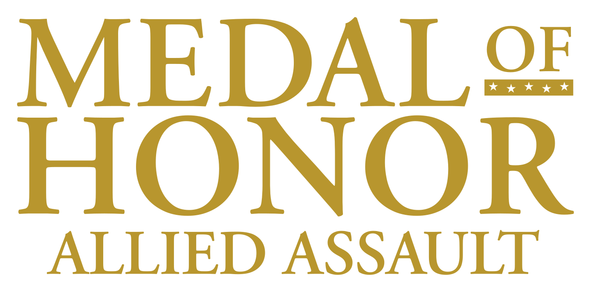 |  | 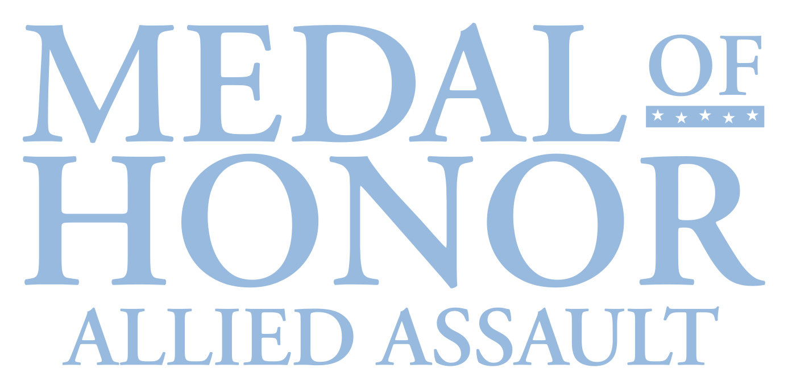 | The original logo's own letters (Adobe Garamond Semibold). |
|  |  |  | Hitmarker Normal Bold, the *Call of Duty* typeface. |
|  |  | 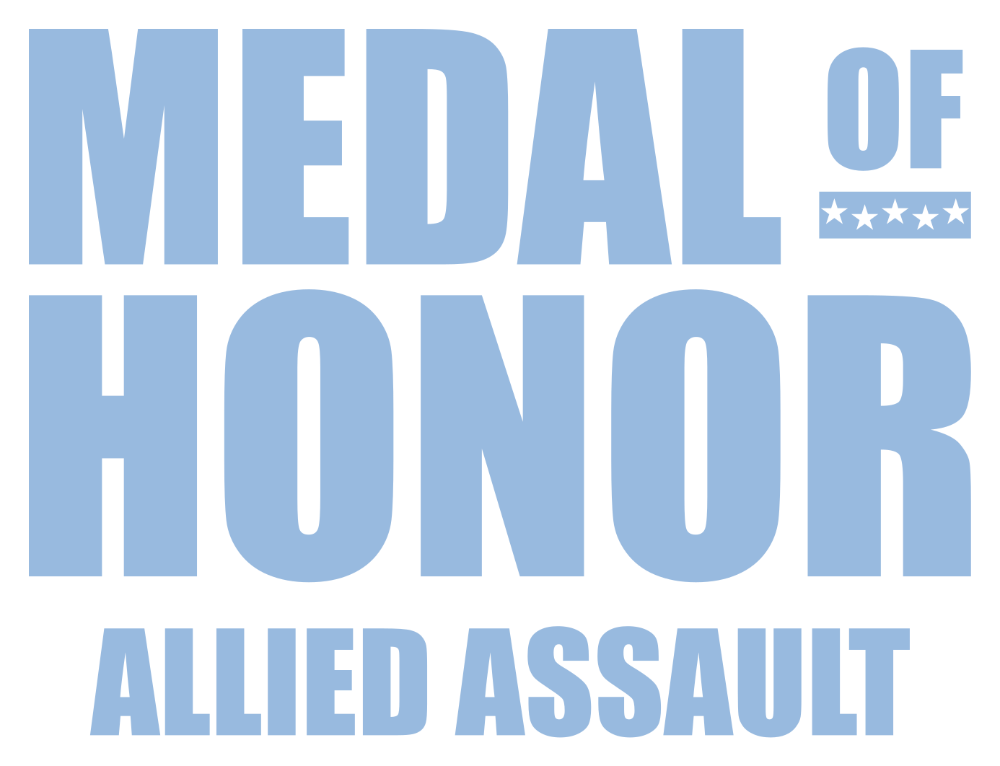 | Impact. |
| 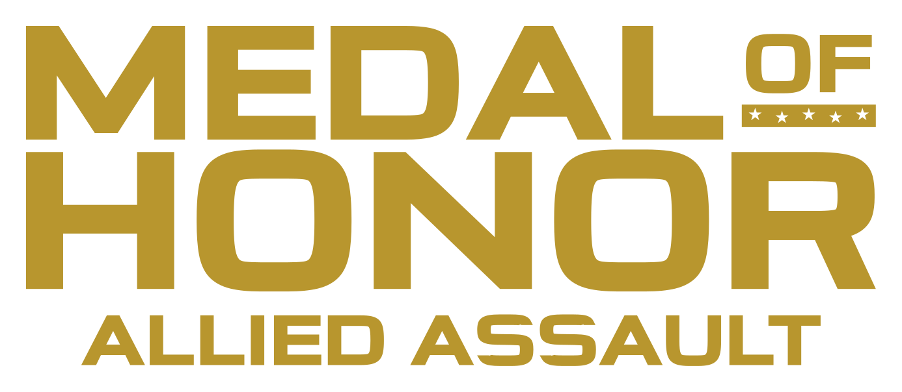 |  |  | Michroma, made bolder like the *Counter-Strike 2* lettering. |

Gold is `#B8962E` and steel blue `#98BADF`.

### Impact wordmarks

MEDAL OF HONOR on one line in Impact, like the pre-2023 *Call of Duty* wordmark, with and without the star bar under OF. For comparison, that wordmark recreated in Impact from memory:

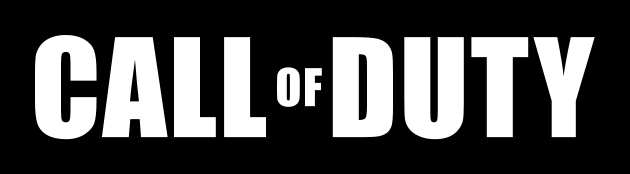

| With the star bar | Without | Version |
|:-:|:-:|---|
| 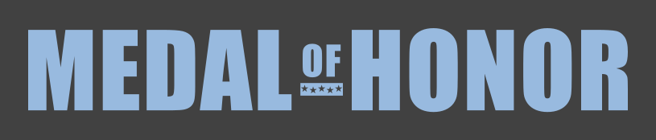 | 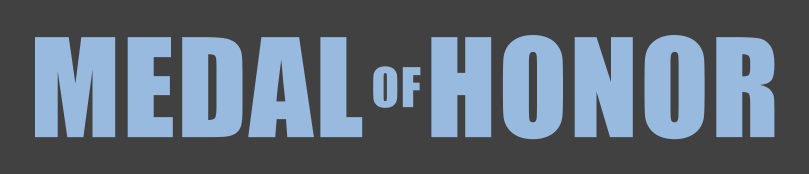 | Original colours: `#98BADF` on `#414141`. |
| 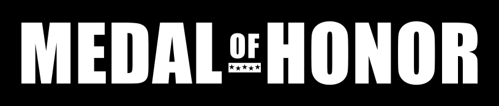 | 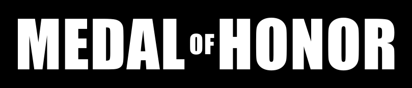 | White on black. |
| 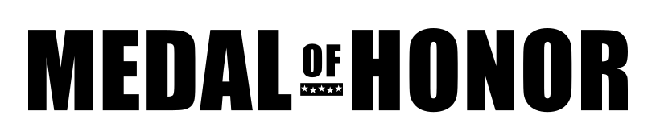 |  | Black on white. |
|  |  | Gold (`#B8962E`), no background. |

The same stacked like the 2023 *Call of Duty* logo, shown here for comparison:

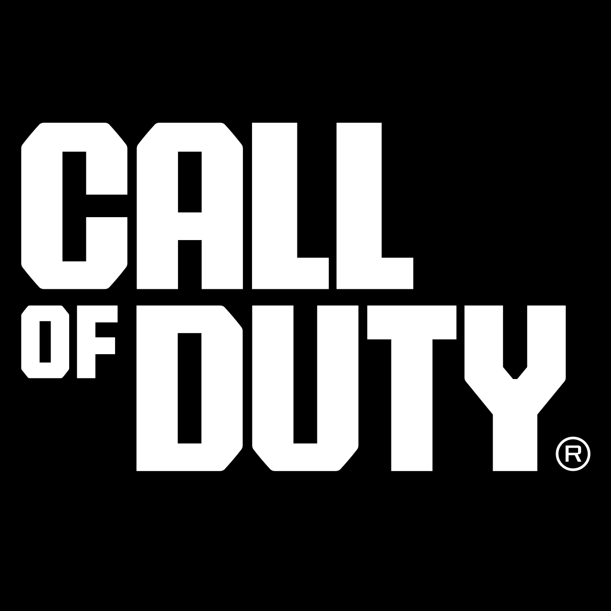

| With the star bar | Without | Version |
|:-:|:-:|---|
|  |  | Original colours: `#98BADF` on `#414141`. |
| 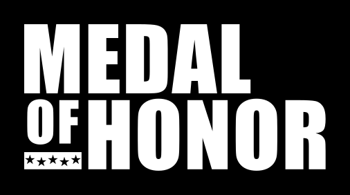 |  | White on black. |
|  |  | Black on white. |
|  | 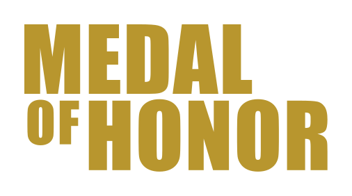 | Gold (`#B8962E`), no background. |

## Credits

The original logo is [`originals/mohaa-logo.svg`](originals/mohaa-logo.svg), from [Wikimedia Commons](https://commons.wikimedia.org/wiki/File:Mohaa_logo.svg), unchanged; its lettering is Adobe Garamond Semibold. The other lettering is [Cinzel](https://github.com/NDISCOVER/Cinzel) and [Michroma](https://github.com/googlefonts/Michroma-font) (both SIL Open Font License 1.1), Impact (Monotype) and Hitmarker (Activision). All lettering is converted to outlines, so no font needs installing. The *Call of Duty* logos are in [`comparison/`](comparison). *Medal of Honor* is a trademark of Electronic Arts, and *Call of Duty* of Activision.
