# moh-icons

SVG icons for *Medal of Honor: Allied Assault* and its two expansions.

Files are sorted by section: [`icons/`](icons) for the game icons, [`launcher/`](launcher) for the launcher icons, [`team/`](team) for the team icons, [`weapons/`](weapons) and [`killfeed/`](killfeed) for the HUD's weapon pictures and kill feed icons, and [`logo/`](logo) for the logos, in [`original/`](logo/original), [`cinzel/`](logo/cinzel), [`wordmark/`](logo/wordmark) and [`impact/`](logo/impact). The games' own icons and logo are in [`originals/`](originals), with the HUD pictures the weapons are traced from, and the *Call of Duty* logos in [`comparison/`](comparison).

| Original&nbsp;design | New&nbsp;design | Alternative | Game | Based on |
|:-:|:-:|:-:|---|---|
|  |  | | Allied Assault | The Allied star, the WWII vehicle marking. No background. |
|  |  |  | Spearhead | Three curved rank chevrons. The alternative has no background. |
|  |  |  | Breakthrough | The Special Forces patch: a dagger and three lightning bolts. The alternative has no background. |
| |  |  | Launcher | A chain link, for connecting to a server. The alternative is two chevrons over a banner, after the Call of Duty Companion logo. |
| |  | | Launcher (alternative) | The chevrons over the Impact wordmark, laid out like the Call of Duty Companion icon. The lettering is too small to read below about 64px. |

All the icons use the same gold (`#B8962E`), and the emblems break through the ring. Spearhead and Breakthrough keep their original backgrounds: green `#244C31` and indigo `#2C2564`. The originals are the games' 32×32 icons, in [`originals/`](originals).

The launcher icons also come in white and steel blue (`#98BADF`):

| Gold | White | Steel blue | Launcher icon |
|:-:|:-:|:-:|---|
|  | 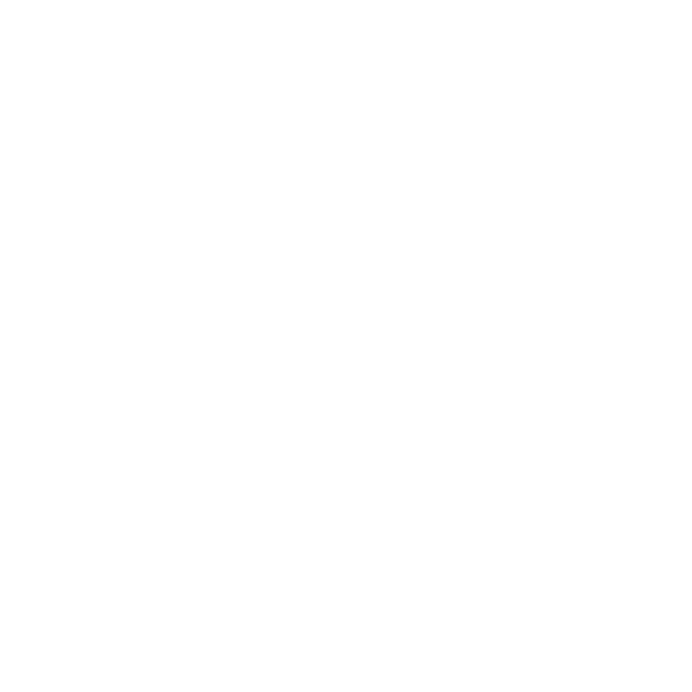 | 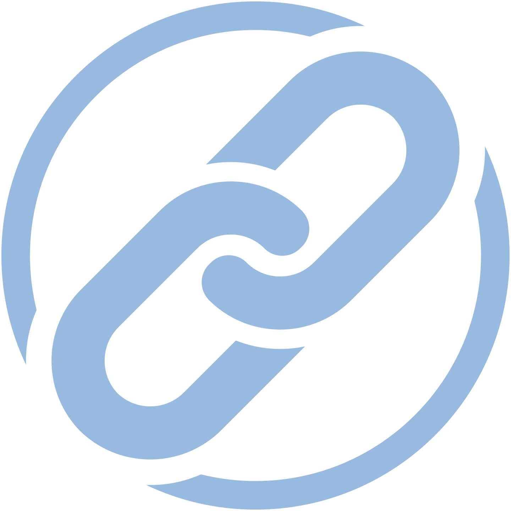 | Chain link. |
|  | 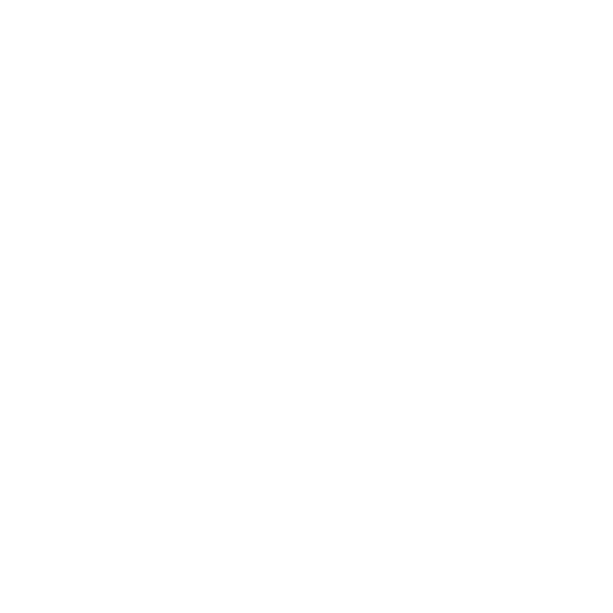 | 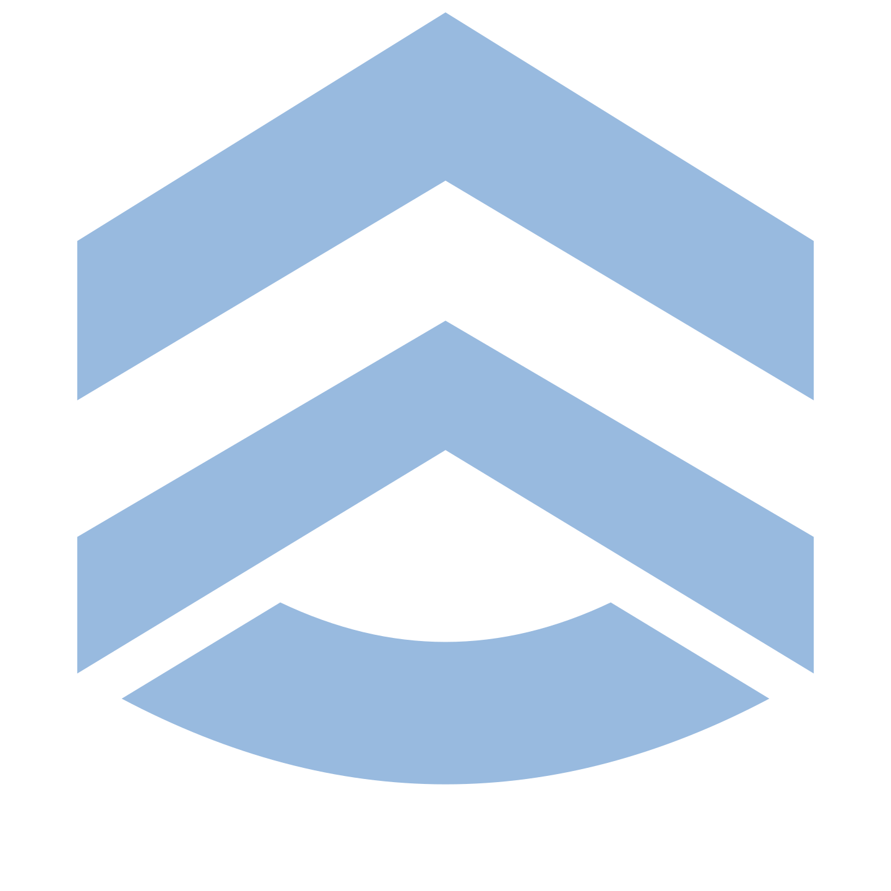 | Chevrons. |
|  | 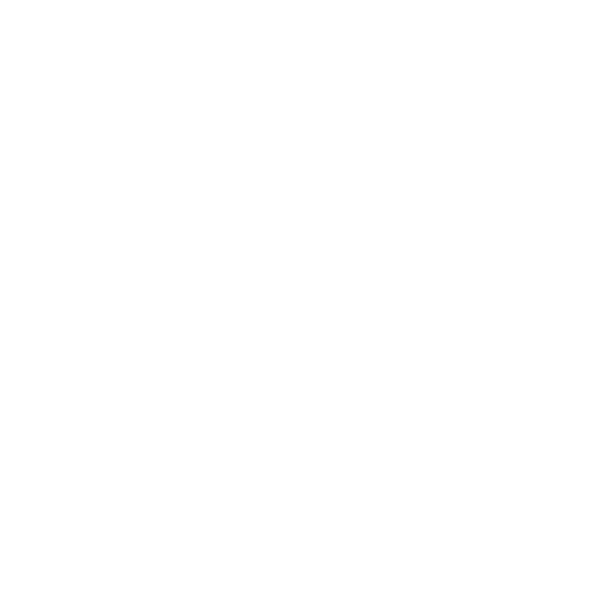 | 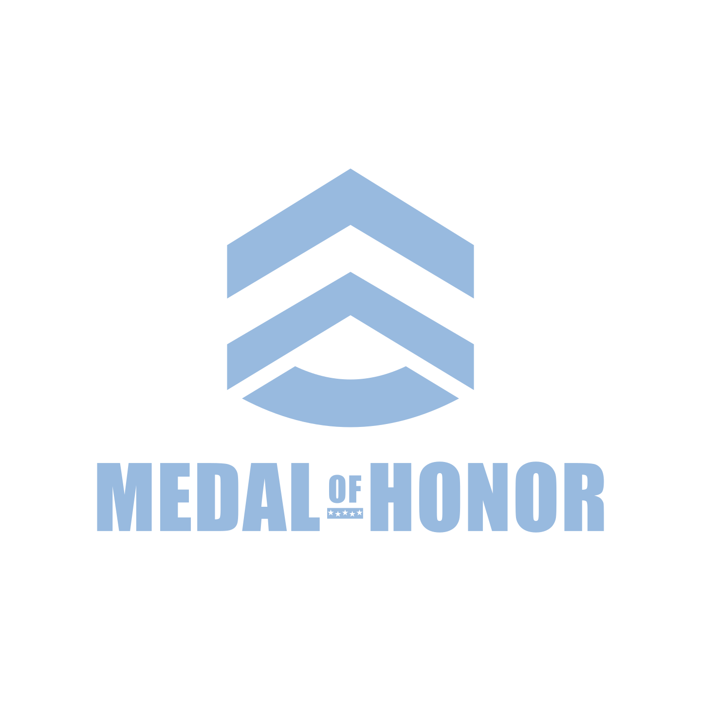 | Chevrons over the Impact wordmark. |

## Team icons

The HUD's team icons, redrawn from the markings they come from. The originals are the game's 32×32 `textures/hud/allies.tga` and `axis.tga` (in `Pak1.pk3`).

| Original&nbsp;design | New&nbsp;design | Team | Based on |
|:-:|:-:|---|---|
|  |  | Allies | The US national aircraft insignia of 19 August 1919 to May 1942, to its official proportions: the star's points touch the blue disc, and the red centre's edge touches the sides of the pentagon inside the star (its radius is the disc's × cos 72°). Blue `#1A1E3B`, white `#FFFFFF` and red `#DE0000`, the colours of the Wikimedia Commons version. |
| 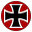 | 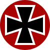 | Axis | The Iron Cross: a black cross with straight flared arms and an even white outline, on the original's red disc. The red is the game's Axis team colour, not part of the cross, and pairs the badge with the Allies disc. Red `#A90303`, white `#FFFFFF` and black `#000000`. |

## Weapons

The HUD's 41 weapon pictures and its 3 kill feed icons (the glove, the headshot and the skull), as outlines. They start from the white silhouettes of Project: Omaha's HUD, PNGs 42 to 606 pixels across, in [`originals/weapons/`](originals/weapons) and [`originals/killfeed/`](originals/killfeed).

[`weapons/traced/`](weapons/traced) and [`killfeed/traced/`](killfeed/traced) are the first step, before any polishing: each PNG traced into curves and corners with potrace, unedited. An SVG's viewBox is its PNG's size in pixels, so the two line up exactly. Filled again at that size, each covers the same pixels as its PNG to within 1.5 % on average, and where the PNG's edge steps from pixel to pixel the outline follows it in small waves. The polished outlines will go in `weapons/` and `killfeed/` themselves, beside these, for a before and after.

Like the originals they are white, the colour the HUD tints, so they don't show on a white page. Here they are on dark grey:

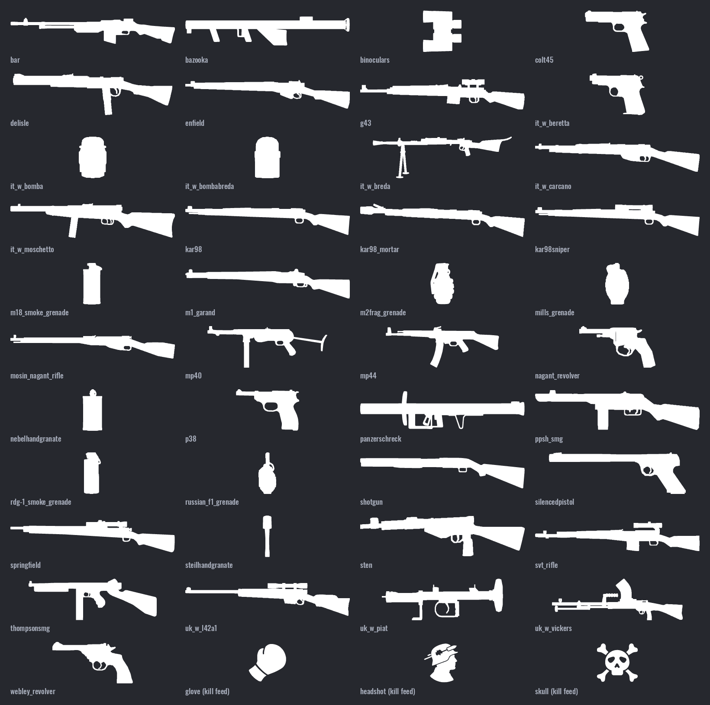

## Logo

The *Allied Assault* logo without its shadows, in its original font (the logo's own Adobe Garamond letters, with stars cut out of the bar) and rebuilt in Cinzel Bold. Each comes with RELOADED in place of ALLIED ASSAULT too, with the frame narrowed around it; in the original font, RELOADED uses letters from the logo itself.

| Original font | Original font, Reloaded | Cinzel | Cinzel, Reloaded | Version |
|:-:|:-:|:-:|:-:|---|
|  |  |  |  | Steel blue `#98BADF` on a dark grey `#414141` plate, the original's colours. |
|  |  |  |  | Steel blue, without the plate. |
|  |  |  |  | White. |
|  |  |  |  | Gold (`#B8962E`). |

### Wordmark

MEDAL, OF over the star bar, HONOR and ALLIED ASSAULT, with no frame or ring, in each font we tried, each also with RELOADED in place of ALLIED ASSAULT at the same size. Each font keeps its own letter spacing, so narrow fonts come out taller.

| Gold | Gold, Reloaded | White | White, Reloaded | Steel blue | Steel blue, Reloaded | Font |
|:-:|:-:|:-:|:-:|:-:|:-:|---|
|  |  |  |  |  |  | Cinzel Bold, from the old launcher icon. |
|  |  |  |  |  |  | The original logo's own letters (Adobe Garamond Semibold). |
|  |  |  |  |  |  | Hitmarker Normal Bold, the *Call of Duty* typeface. |
|  |  |  |  |  |  | Impact. |
|  |  |  |  |  |  | Michroma, made bolder like the *Counter-Strike 2* lettering. |

Gold is `#B8962E` and steel blue `#98BADF`.

### Impact wordmarks

MEDAL OF HONOR on one line in Impact, with and without the star bar under OF. The Reloaded versions add RELOADED underneath, at the size of the original logo's third line. The layout follows the pre-2023 *Call of Duty* wordmark, recreated here in Impact from memory:

| With the star bar | Reloaded | Without | Reloaded | Version |
|:-:|:-:|:-:|:-:|---|
|  |  |  |  | Original colours: `#98BADF` on `#414141`. |
|  |  |  |  | White on black. |
|  |  |  |  | Black on white. |
|  |  |  |  | Gold (`#B8962E`), no background. |
| 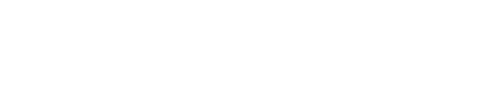 | 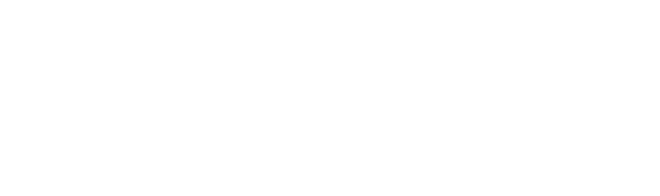 | 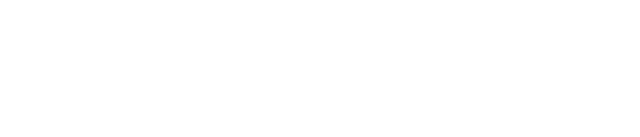 | 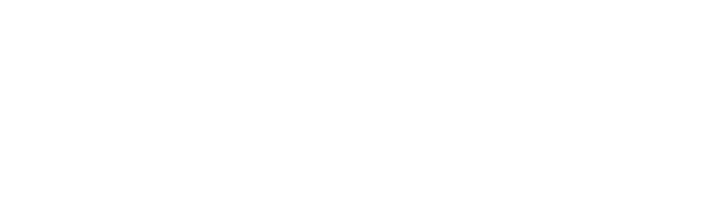 | White, no background. |
| 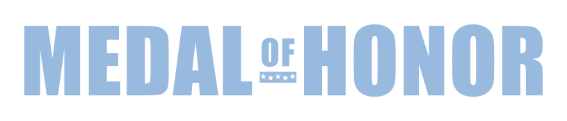 | 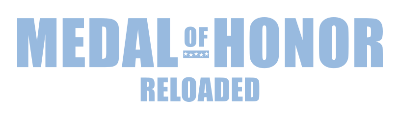 | 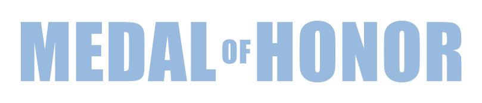 | 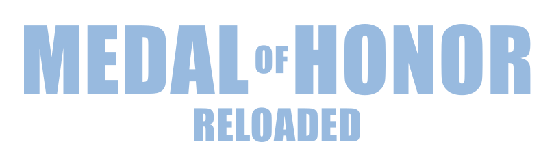 | Steel blue (`#98BADF`), no background. |

The same, stacked. Here RELOADED is as wide as the block, which squares it off. The layout follows the 2023 *Call of Duty* logo:

| With the star bar | Reloaded | Without | Reloaded | Version |
|:-:|:-:|:-:|:-:|---|
|  |  |  |  | Original colours: `#98BADF` on `#414141`. |
|  |  |  |  | White on black. |
|  |  |  |  | Black on white. |
|  |  |  |  | Gold (`#B8962E`), no background. |
| 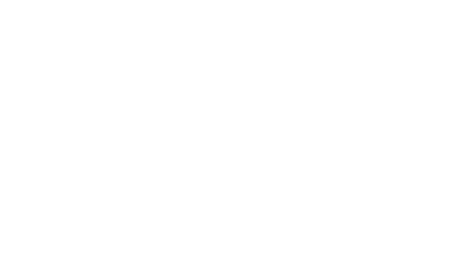 | 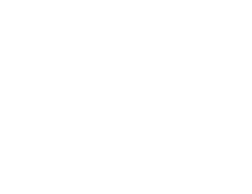 | 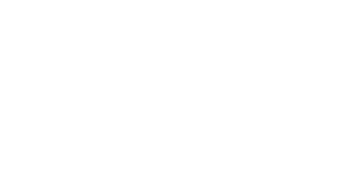 | 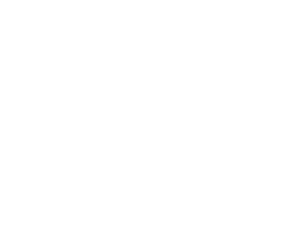 | White, no background. |
| 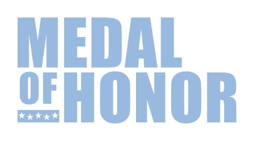 | 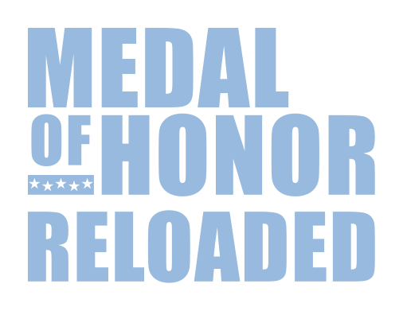 | 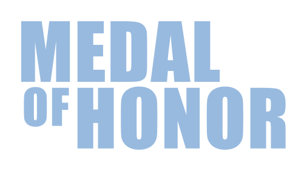 | 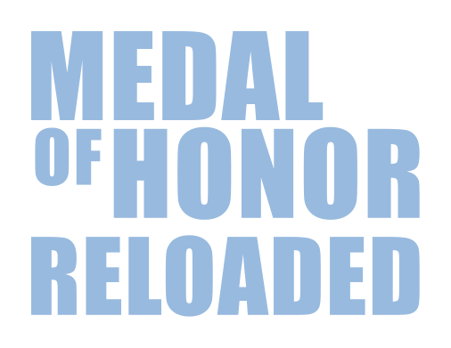 | Steel blue (`#98BADF`), no background. |

With OF, the star bar and AA in a column after MEDAL and HONOR, which are spaced to the same width: OF level with the top of MEDAL, AA with the foot of HONOR, and the bar between the lines. The Reloaded versions keep AA and add RELOADED underneath, as wide as the block.

| With the star bar | Reloaded | Without | Reloaded | Version |
|:-:|:-:|:-:|:-:|---|
|  |  | 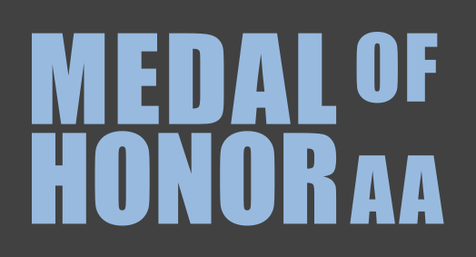 | 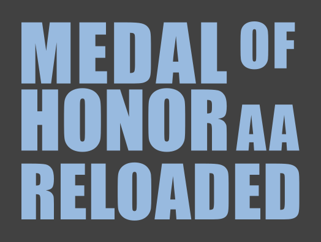 | Original colours: `#98BADF` on `#414141`. |
|  |  | 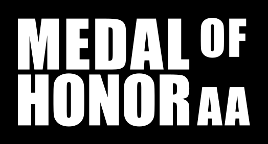 | 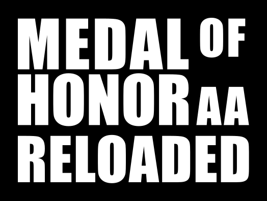 | White on black. |
|  |  | 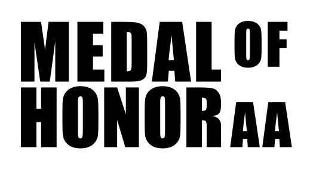 | 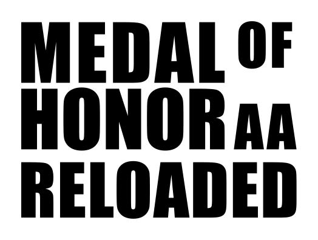 | Black on white. |
|  |  | 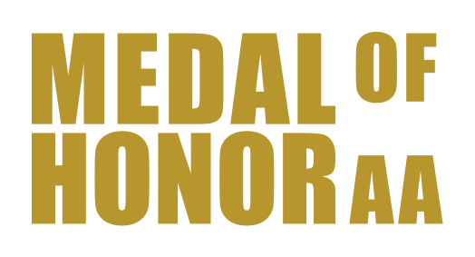 | 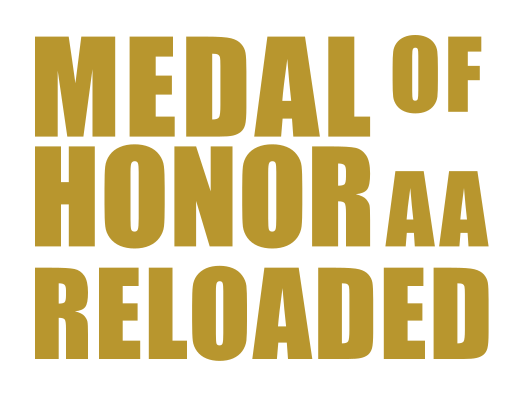 | Gold (`#B8962E`), no background. |
| 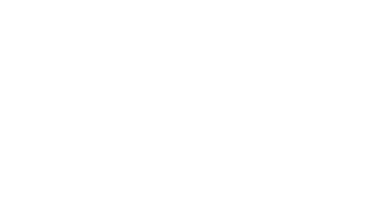 | 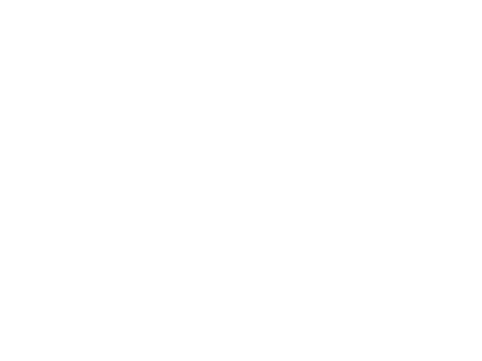 | 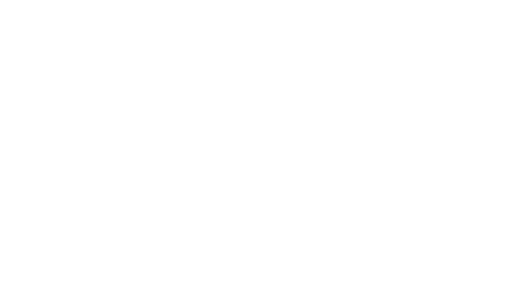 | 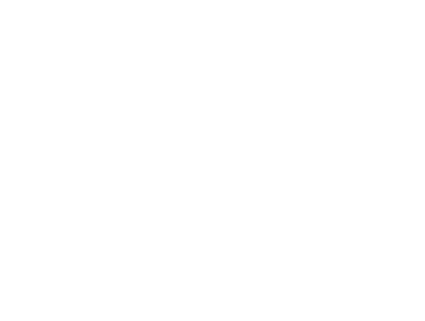 | White, no background. |
| 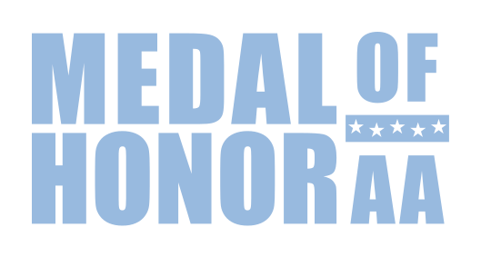 | 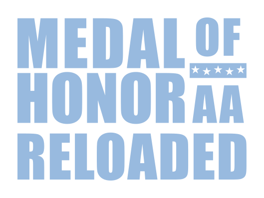 | 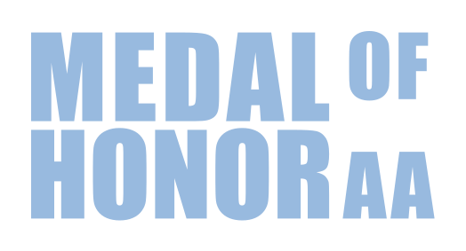 | 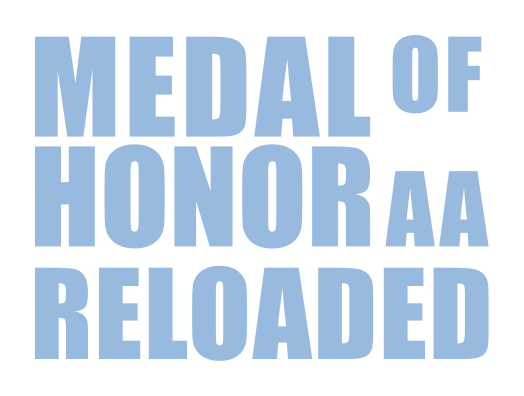 | Steel blue (`#98BADF`), no background. |

## Credits

The original logo is [`originals/mohaa-logo.svg`](originals/mohaa-logo.svg), from [Wikimedia Commons](https://commons.wikimedia.org/wiki/File:Mohaa_logo.svg), unchanged; its lettering is Adobe Garamond Semibold. The other lettering is [Cinzel](https://github.com/NDISCOVER/Cinzel) and [Michroma](https://github.com/googlefonts/Michroma-font) (both SIL Open Font License 1.1), Impact (Monotype) and Hitmarker (Activision). All lettering is converted to outlines, so no font needs installing. *Medal of Honor* is a trademark of Electronic Arts, and *Call of Duty* of Activision. The Allies team icon is the US national aircraft insignia, a US government work in the public domain, matching the [Wikimedia Commons drawing](https://commons.wikimedia.org/wiki/File:Roundel_of_the_United_States_(1919%E2%80%931941).svg). The Axis cross is drawn here from scratch. The weapon pictures and kill feed icons come from Project: Omaha's HUD, used with its author's permission.
