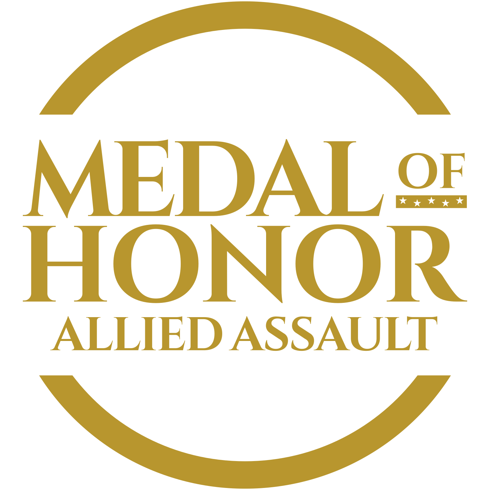

# moh-icons

SVG icons for *Medal of Honor: Allied Assault* and its two expansions.

| Original&nbsp;design | New&nbsp;design | Game | Based on |
|:-:|:-:|---|---|
|  |  | Allied Assault | The Allied star: the star-in-a-circle marking painted on Allied vehicles in WWII. It has no background, so whatever is behind it shows through the gaps. |
|  |  | Spearhead | The military chevron: three stacked like a sergeant's stripes. The chevrons are curved, like real rank insignia, instead of the original icon's straight ones. |
| |  | Spearhead (alternative) | The same chevrons with no background, so whatever is behind them shows through the gaps. |
|  |  | Breakthrough | The US Army Special Forces patch: a dagger crossed by three lightning bolts. |
| |  | Breakthrough (alternative) | The same dagger and bolts with no background, so whatever is behind them shows through the gaps. |
| |  | Launcher | A chain link, for connecting to a server. Like the Allied Assault icon, it has no background, so whatever is behind it shows through the gaps. |
| |  | Launcher (alternative) | The game's wordmark, redrawn flat: MEDAL, OF over a bar of five stars, HONOR and ALLIED ASSAULT, set to the original logo's proportions. The ring opens in a straight band where the lettering crosses it. Best at larger sizes, since the small lettering can't be read below about 64px. |
| |  | Launcher (alternative) | Two chevrons over a curved banner, from the Call of Duty Companion app logo, redrawn mirror-symmetric and filled. It has no ring and no background, and reads clearly down to 16px. |

All the icons use the same gold (`#B8962E`). Like the Allied star, the Spearhead, Breakthrough and chain-link launcher emblems break through the gold ring where they reach it. The Spearhead and Breakthrough backgrounds match the original icons: green `#244C31` for Spearhead and indigo `#2C2564` for Breakthrough. Their alternatives drop the background, like the Allied Assault and launcher icons.

The originals are the games' 32×32 icons, kept in [`originals/`](originals).

The wordmark launcher icon's lettering is set in [Cinzel](https://github.com/NDISCOVER/Cinzel) (SIL Open Font License 1.1), converted to outlines so the icon needs no font installed.

## Logo

The *Medal of Honor: Allied Assault* logo: MEDAL, OF over a bar of five stars, HONOR and ALLIED ASSAULT inside a stepped frame. Each version also comes with RELOADED in place of ALLIED ASSAULT, on the same line and at the same size; there the frame's lower part narrows into a tab around RELOADED, leaving it the same margins ALLIED ASSAULT has. None of the versions has shadows.

| Allied Assault | Reloaded | Version |
|:-:|:-:|---|
|  |  | The original logo with its drop shadows removed, and with five stars cut out of the bar under OF. (The original's own stars were the same blue as their bar and showed only through their shadows.) RELOADED's letters come from the logo itself: E, L, A and D from ALLIED, and R and O from HONOR, scaled down. |
|  |  | The same without the plate, so whatever is behind it shows through the frame and the stars. |
|  |  | Rebuilt from scratch with the lettering in Cinzel Bold, the M narrowed to the logo's proportions (as in the wordmark launcher icon), in the original's colours: steel blue `#98BADF` on a dark grey `#414141` plate. The lines keep the original's heights and layout, and the frame is fitted around the lettering with the original's margins. The stars are cut out of the bar. |
|  |  | The Cinzel version without the plate, in the same steel blue. |
|  |  | The Cinzel version in white, with no plate. |
|  |  | The Cinzel version in the icons' gold (`#B8962E`), with no plate. |

### Impact wordmark

A single-line MEDAL OF HONOR, laid out like the pre-2023 *Call of Duty* wordmark: MEDAL and HONOR in Impact, with a small OF between them over the bar of five stars, in the original logo's proportions. OF and the bar together are centred on the height of MEDAL and HONOR.

| Logo | Version |
|:-:|---|
|  | In the original logo's colours: steel blue `#98BADF` on dark grey `#414141`. |
|  | White on black. |
|  | Black on white. |

The original logo is [`originals/mohaa-logo.svg`](originals/mohaa-logo.svg), from [Wikimedia Commons](https://commons.wikimedia.org/wiki/File:Mohaa_logo.svg), kept unchanged. Its lettering is Adobe Garamond Semibold, converted to outlines. The rebuilt logos' lettering is [Cinzel](https://github.com/NDISCOVER/Cinzel) (SIL Open Font License 1.1), and the Impact wordmark's is Impact (Monotype); both are converted to outlines, so none of the files needs a font installed. *Medal of Honor* and its logo are trademarks of Electronic Arts.
